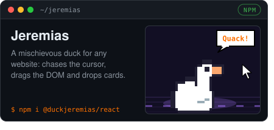

 

  &nbsp;
  &nbsp;
  

🌐 Read in: <b>English</b> · <a href="multilingual-readme/pt-BR/README.md">Português (BR)</a> · <a href="multilingual-readme/es/README.md">Español</a> · <a href="multilingual-readme/fr/README.md">Français</a> · <a href="multilingual-readme/ja-JA/README.md">日本語</a> · <a href="multilingual-readme/zh/README.md">中文</a>

