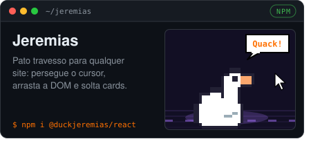
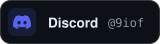

 

  &nbsp;
  &nbsp;
  

🌐 Leia em: <a href="../../README.md">English</a> · <b>Português (BR)</b> · <a href="../es/README.md">Español</a> · <a href="../fr/README.md">Français</a> · <a href="../ja-JA/README.md">日本語</a> · <a href="../zh/README.md">中文</a>

